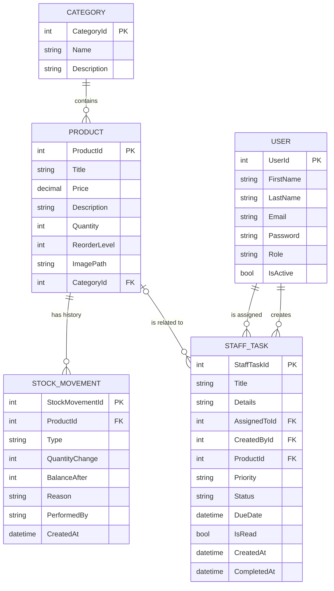

# StockPilot

**Warehouse and inventory management system with an AI assistant.**

StockPilot helps a team keep track of products, categories and stock levels. Every change to the stock is recorded as a movement (who, when, why), managers can control the team and assign tasks, and an AI assistant answers questions about the live inventory in plain language.

Built with **ASP.NET Core MVC**, **Entity Framework Core** and **SQL Server**.

---

## Table of contents

1. [Screenshots](#screenshots)
2. [Features](#features)
3. [Tech stack](#tech-stack)
4. [Project structure](#project-structure)
5. [Database design](#database-design)
6. [Roles and permissions](#roles-and-permissions)
7. [Business rules](#business-rules)
8. [AI assistant](#ai-assistant)
9. [Pages and routes](#pages-and-routes)
10. [Getting started](#getting-started)
11. [Troubleshooting](#troubleshooting)
12. [Known limitations and roadmap](#known-limitations-and-roadmap)

---

## Screenshots

> Add your own screenshots to `docs/screenshots/` and keep the file names below (or update the links).

| Home | Dashboard |
|---|---|
|  |  |

| Products | Stock movements |
|---|---|
|  |  |

| AI assistant | Team and tasks |
|---|---|
|  |  |

---

## Features

### Inventory
- Full CRUD for **products** and **categories**, with server-side and client-side validation (Data Annotations and jQuery unobtrusive validation).
- Product images: upload, replace and display.
- Products page grouped by category, with horizontal scrolling rows, search by title, category filter and sorting.
- **Reorder level per product**: each product has its own minimum, and its status (In stock, Low stock, Out of stock) is calculated from it.
- Duplicate protection: category names and user emails are unique.

### Stock movements
- Three movement types: **Stock In**, **Stock Out** and **Adjustment** (physical count).
- Every movement stores the quantity change, the balance after it, the reason, the user and the time.
- History page with filters (type, product, date range, text search), totals and pagination.
- Live preview of the new stock level before saving.

### Dashboard
- KPIs: total products, inventory value, low stock, out of stock.
- Charts (Chart.js): products per category, stock per category, top products by inventory value.
- "Needs attention" list of products at or below their reorder level.

### Excel import and export
- Export the catalog to a formatted `.xlsx` file (with calculated stock value and status).
- Import products from Excel: columns are read by name, missing categories are created, existing products are updated, invalid rows are skipped and reported with the reason.
- Downloadable import template.

### Team and tasks
- **Manager** role: manage team members (change role, enable or disable accounts, delete).
- Managers can **send tasks** to a specific user with a priority, a due date and an optional related product.
- Users get an unread badge in the sidebar and a banner on the home page, and handle their tasks from **My Tasks** (start, mark as done, reopen).
- Managers track everything in **Sent Tasks**, including overdue ones.

### AI assistant
- Chat interface that answers questions about products, prices, stock levels and categories using the live database. See [AI assistant](#ai-assistant).

### Authentication
- Register and login with session-based authentication.
- "Remember me" cookie for automatic sign-in.
- Disabled or deleted accounts are signed out on their next request.

---

## Tech stack

| Layer | Technology |
|---|---|
| Framework | ASP.NET Core MVC (.NET 10) |
| Data access | Entity Framework Core (code first, migrations, seed data) |
| Database | SQL Server |
| Views | Razor, Tag Helpers, Bootstrap 5, Bootstrap Icons |
| Charts | Chart.js |
| Excel | ClosedXML |
| AI | Google Gemini API |
| Auth | Session and cookie based, custom action filter for roles |

---

## Project structure

```
FinalProject/
├── Context/            MydbContext (DbSets, relationships, seed data)
├── Controllers/        Home, User, Product, Category, Stock, Dashboard,
│                       Chat, Team, Tasks
├── Models/             User, Product, Category, StockMovement, StaffTask, Roles
├── ViewModels/         Form and page models (kept separate from entities)
├── Views/              Razor views, shared layout, partials
├── ViewComponents/     StockAlert (sidebar badge), TaskBadge (unread tasks)
├── Filters/            ManagerOnlyAttribute (role check against the database)
├── Helpers/            UI helpers (task pills, relative time)
├── Services/           GeminiService (AI integration)
├── Migrations/         EF Core migrations
└── wwwroot/            Static files, uploaded product images, shared CSS
```

**Design notes**

- **ViewModels** are used for every form so entities are never bound directly, and so pages can carry extra data (dropdown lists, counters, filters).
- **Dependency injection** is used for the `DbContext` and services.
- **Authorization** is enforced on the server: the `ManagerOnly` filter and a middleware that refreshes the role and active status from the database on each request. Hiding buttons in the UI is only a convenience, not the protection.

---

## Database design



**Relationships**

- A category has many products, and each product belongs to one category.
- A product has many stock movements (deleted together with the product).
- A task references two users (assigned to, created by) and optionally a product. If the product is deleted, the task is kept and the link is cleared.
- `Price` is stored as `decimal(18,2)`.

---

## Roles and permissions

| Area | Guest | User | Manager |
|---|:---:|:---:|:---:|
| Home, Register, Login | ✅ | ✅ | ✅ |
| Products and categories | ❌ | ✅ | ✅ |
| Stock movements | ❌ | ✅ | ✅ |
| Dashboard | ❌ | ✅ | ✅ |
| Excel import and export | ❌ | ✅ | ✅ |
| AI assistant | ❌ | ✅ | ✅ |
| My Tasks | ❌ | ✅ | ✅ |
| Team management | ❌ | ❌ | ✅ |
| Send tasks and Sent Tasks | ❌ | ❌ | ✅ |

A Manager account is created by the seed data (see `MydbContext.OnModelCreating`). Change its credentials before deploying anywhere public.

---

## Business rules

**Stock**
- The quantity of a product is never edited directly. It only changes through stock movements.
- A new product with an initial quantity records an **Initial stock** movement, and an Excel import records its changes as movements too.
- **Stock Out** cannot exceed the available quantity.
- **Adjustment** takes the counted quantity and records the difference.
- Quantity is limited to 100,000 units per product.
- Status: **Out of stock** when the quantity is 0, **Low stock** when it is at or below the product's reorder level, otherwise **In stock**.

**Excel import**
- Only `.xlsx` files up to 5 MB.
- Required columns: `Title`, `Category`, `Price`, `Quantity`. Optional: `Description`.
- A row matches an existing product by **title and category**. Matches are updated, others are created.
- Invalid rows are skipped and listed with a reason, while valid rows are still saved.

**Team and tasks**
- New registrations are always **User**. There is no way to register as a manager.
- A manager cannot change their own role, disable or delete their own account, so the system always has a manager.
- Tasks can only be sent to active users other than the sender. A due date cannot be in the past.

---

## AI assistant

The assistant answers questions about the inventory in natural language, for example:

- "Which products are low in stock?"
- "What is the cheapest product?"
- "How many products do we have in Electronics?"

**How it works**

1. The user sends a question from the chat page to `POST /Chat/Ask` (the user must be signed in).
2. `ChatController` builds a snapshot of the current inventory from the database (title, price, quantity, reorder level, category, description).
3. `GeminiService` sends the snapshot and the question to the Gemini API, instructing it to answer only from that data.
4. The answer is returned as JSON (`{ "answer": "..." }`) and rendered in the chat window with a typing indicator.

Because the data is read from the database on every request, answers always reflect the current stock.

**Notes**

- The API key is never stored in the repository. It is read from configuration (user secrets in development).
- Sending the whole snapshot is fine for small and medium catalogs. For very large catalogs the data should be filtered or retrieved first (see the roadmap).

---

## Pages and routes

| Route | Description |
|---|---|
| `/` | Home |
| `/User/Register`, `/User/Login`, `/User/Logout` | Authentication |
| `/Product/GetAllProducts` | Products grouped by category (search, filter, sort) |
| `/Product/Create`, `/Edit/{id}`, `/Details/{id}`, `/Delete/{id}` | Product management |
| `/Product/Import`, `/Product/ExportToExcel`, `/Product/DownloadTemplate` | Excel import and export |
| `/Category/Index` and `/Create`, `/Edit/{id}`, `/Details/{id}`, `/Delete/{id}` | Category management |
| `/Stock` | Stock movements history |
| `/Stock/Create` | Record stock in, stock out or adjustment |
| `/Dashboard` | KPIs and charts |
| `/Chat` | AI assistant |
| `/Tasks` | My tasks |
| `/Tasks/Send`, `/Tasks/Sent` | Send tasks and track them (managers) |
| `/Team` | Team management (managers) |

---

## Getting started

### Prerequisites

- [.NET SDK](https://dotnet.microsoft.com/download) (the version the project targets)
- SQL Server, SQL Server Express or LocalDB
- A [Google Gemini API key](https://aistudio.google.com/) for the AI assistant
- Visual Studio 2022 or later, or any editor with the .NET CLI

### 1. Clone the repository

```bash
git clone https://github.com/<your-username>/StockPilot.git
```

Then open a terminal in the folder that contains `FinalProject.csproj`.

### 2. Configure the database

Edit the connection string in `appsettings.json`:

```json
{
  "ConnectionStrings": {
    "DefaultConnection": "Server=localhost\\SQLEXPRESS;Database=FinalProject;Trusted_Connection=True;TrustServerCertificate=true;MultipleActiveResultSets=true"
  }
}
```

### 3. Add your Gemini API key

Keep the key out of source control by using user secrets:

```bash
dotnet user-secrets init
dotnet user-secrets set "Gemini:ApiKey" "<your-api-key>"
```

### 4. Create the database

```bash
dotnet tool install --global dotnet-ef   # once
dotnet ef database update
```

Or, in Visual Studio, open **Package Manager Console** and run `Update-Database`. The migrations create the schema and the seed data.

### 5. Run

```bash
dotnet run
```

Open the URL printed in the terminal, register a new account (it will be a regular user), or sign in with the seeded manager account to see the manager features.

---

## Troubleshooting

| Problem | What to do |
|---|---|
| `Add-Migration` stops with warning **NU1902** | A transitive package (`System.Security.Cryptography.Pkcs`) has a known vulnerability. Add a reference to a patched version of it, or run `$ErrorActionPreference = "Continue"` in the Package Manager Console and retry. |
| Cannot connect to SQL Server | Check the instance name in the connection string (`localhost\SQLEXPRESS`, `(localdb)\MSSQLLocalDB`, ...) and that the service is running. |
| The AI assistant returns an error | Make sure the API key is configured (`dotnet user-secrets list`) and that the key is valid. |
| Product images do not appear | Check that `wwwroot/images` exists and is writable. |
| Styles look outdated after an update | Hard refresh the browser (`Ctrl + Shift + R`). |

---

## Known limitations and roadmap

**Known limitations**

- Passwords are currently stored as plain text. They must be hashed (for example with BCrypt) before any real deployment.
- Product and category management is available to every signed-in user and is not yet restricted by role.
- Notifications appear when a page loads or refreshes, not instantly.
- If two users record a movement for the same product at the exact same moment, the last write wins (no concurrency token yet).

**Roadmap**

- [ ] Password hashing (BCrypt)
- [ ] Restrict product and category changes to managers, and add a storekeeper role
- [ ] Real-time notifications with SignalR
- [ ] Multiple warehouses and transfers between them
- [ ] Suppliers and purchase orders (receiving creates Stock In movements)
- [ ] Batch and expiry date tracking
- [ ] AI restock suggestions and generated inventory reports
- [ ] Conversation memory for the assistant
- [ ] Concurrency tokens for stock updates
- [ ] Unit and integration tests

---

## Author

**Your name** · [LinkedIn](https://www.linkedin.com/in/your-profile) · [GitHub](https://github.com/your-username)
